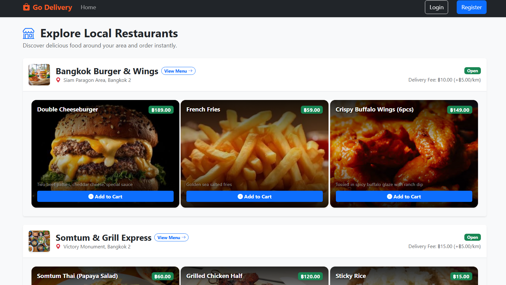

# 🛵 Food Delivery Web Application

A full-stack multi-restaurant food delivery web application built with **Go**, **Gin**, **HTMX**, **PostgreSQL**, **Bootstrap 5**, and **MinIO (S3)** object storage.



---

## ✨ Features

- **🛍️ Customer Flow**: Browse open restaurants, Netflix-style cinematic food menu cards, distance-based Haversine delivery fee calculation, server-side basket session, and live order tracking.
- **🏪 Restaurant Dashboard**: Manage restaurant profiles, menu items with MinIO public image uploads, toggle store open/close status, and process incoming/active orders.
- **🚴 Rider Workflow**: Interactive order claim board, active delivery navigation, and private proof photo proxy uploads (pickup & delivery verification).
- **🛡️ Admin Panel**: System administration metrics, role management, searchable paginated tables for Users, Registered Restaurants, and System Orders with status override controls.
- **🔒 Role-Based Access & Auth**: Session-based auth with PostgreSQL session store (`pgstore`), password hashing via `bcrypt` (cost 12), and role-based middleware (`admin`, `staff`, `restaurant`, `rider`, `customer`).

---

## 🛠️ Tech Stack

- **Backend**: Go 1.22+, Gin Web Framework
- **Frontend**: HTMX (SSR Partial Updates), Bootstrap 5, HTML Templates
- **Database**: PostgreSQL 18 with GORM ORM & Native `order_status` ENUM
- **Object Storage**: MinIO (S3-compatible API via AWS SDK Go v2)
- **Sessions & Auth**: `gorilla/sessions` + `pgstore`, `golang.org/x/crypto/bcrypt`
- **Config & Tooling**: `godotenv`, Air (Live Reload)

---

## 🚀 Development Setup

### Prerequisites

- **Go** `1.22+` installed
- **Docker** & **Docker Compose** installed

### 1. Clone & Environment Setup

```bash
git clone https://github.com/dreamoutbox/delivery-app.git
cd delivery-app
cp .env.example .env
```

### 2. Start Services (PostgreSQL & MinIO)

```bash
docker compose up -d
```

### 3. Seed Database & Upload Mock Images

Run the automated seeder script to initialize models, create PostgreSQL ENUM types, create default accounts, and upload mock imagery to MinIO:

```bash
./run-seed.sh
```

### 4. Run Server

Start the application server:

```bash
go run ./cmd/server
```

Or run with **Air** live-reloader:

```bash
air
```

Open **`http://localhost:8080`** in your browser.

---

### 🔑 Demo Accounts (Password: `password123`)

| Role | Email |
| :--- | :--- |
| **Admin** | `admin@example.com` |
| **Restaurant Owner** | `owner1@example.com` / `owner2@example.com` |
| **Rider** | `rider1@example.com` |
| **Customer** | `customer1@example.com` |
